# Private Share

**Encrypted voice calls, video calls, screen sharing and file transfer between two browsers, on phone or PC.**
The server only signs people in and introduces the two devices; everything you say, show and send travels device to device.


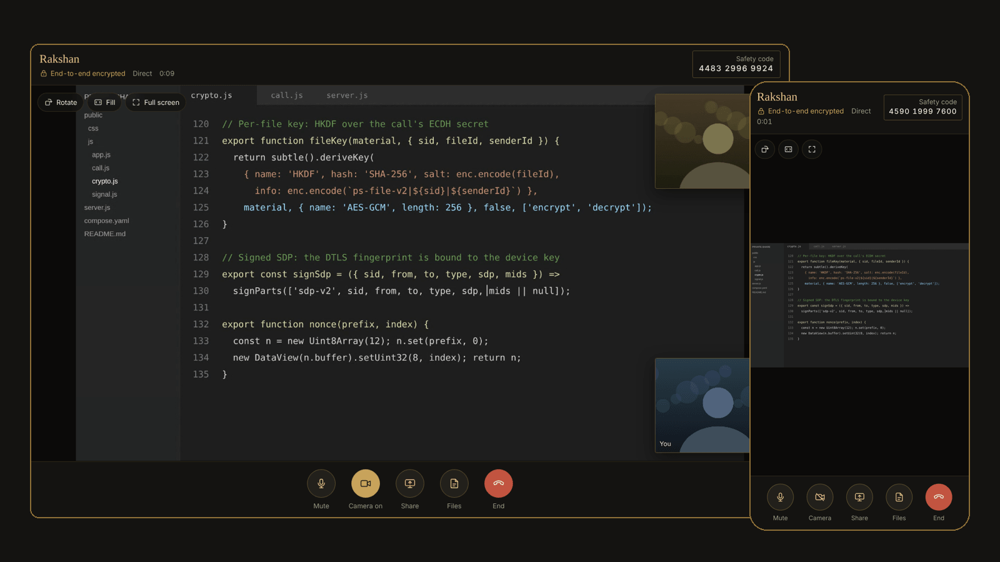

## Features

| | |
| --- | --- |
| **Voice and video calls** | Phone to laptop in any direction. Mute, camera on/off and front/back switch, and a voice call becomes a video call without redialling. |
| **Screen sharing with sound** | Share a tab, a window or the whole screen, including its audio in Chrome and Edge. Viewers on any device can rotate, fill or go full screen. |
| **File transfer** | Send files up to 1 GB each, with or without a call. Every file is encrypted, verified on arrival and only then offered for saving. |
| **End-to-end encryption** | Keys are created and kept in each browser. A 12-digit safety code lets two people confirm out loud that nobody is in the middle. |
| **No storage** | No database, no uploads and no message history. The server keeps sign-ins and online status in memory and nothing else. |

## Screenshots

> From a local test run with three browsers (two desktops, one phone). The camera feeds and the shared screen are generated test content. The sign-in page shows the local test sign-in; the live site shows "Continue with Google".

**Sign in and choose someone**

| Desktop | Phone |
| --- | --- |
| 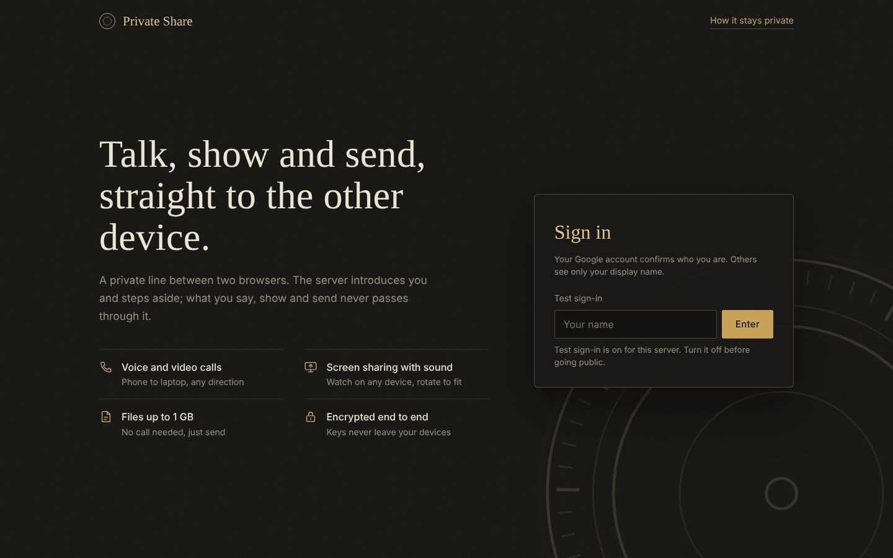 | 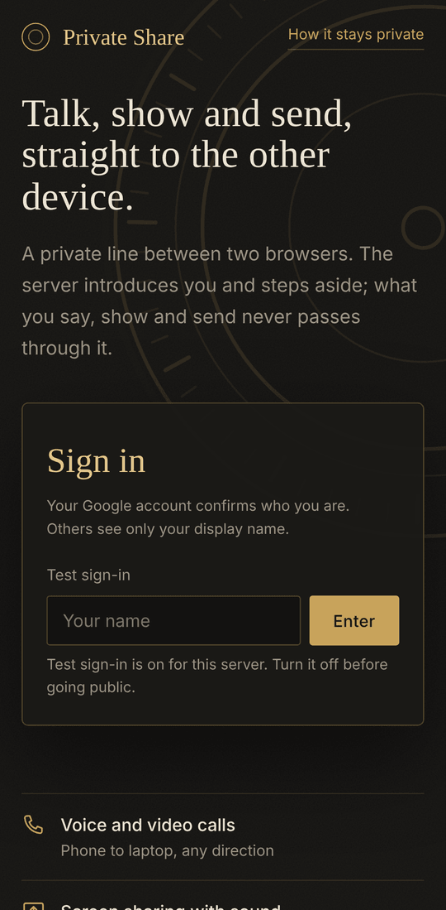 |
| 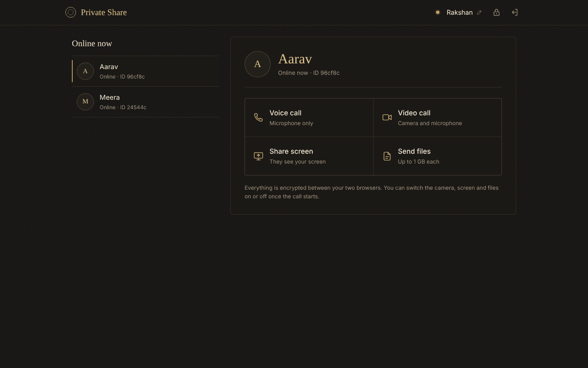 | 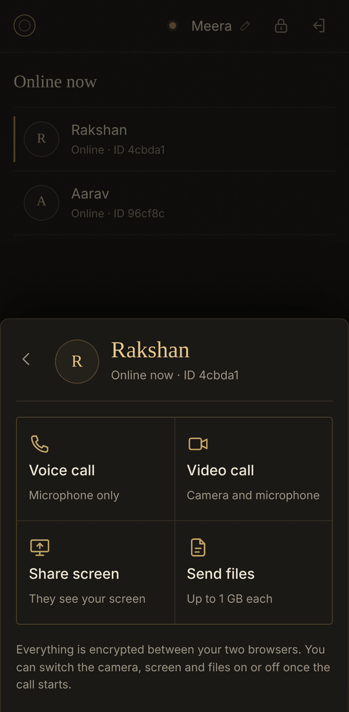 |

**Video call**, end-to-end encrypted, with a safety code both people can compare

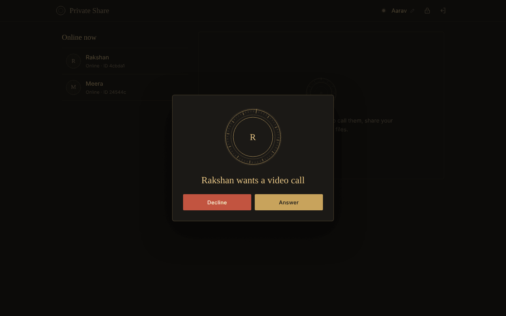 
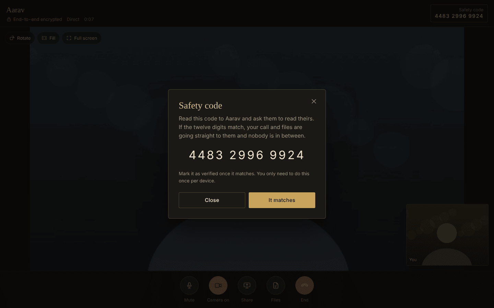

**Screen sharing with sound.** The viewer can rotate, fill or go full screen.

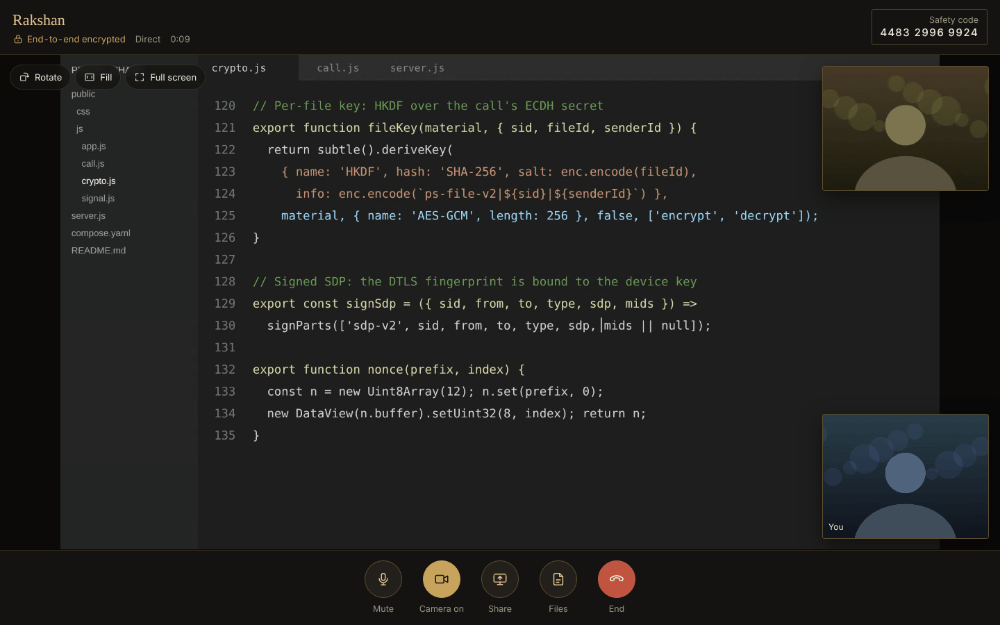 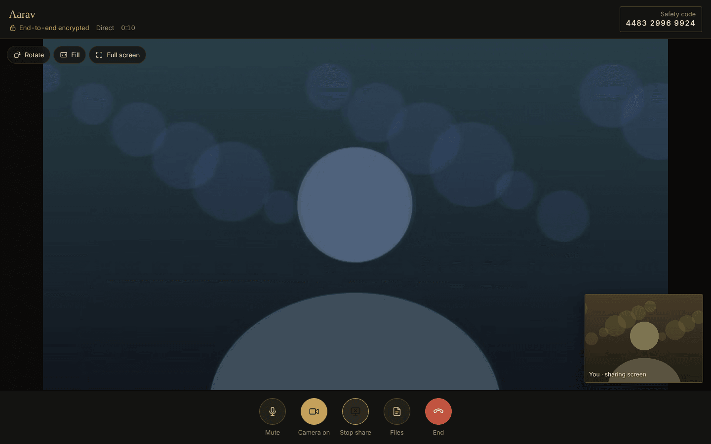

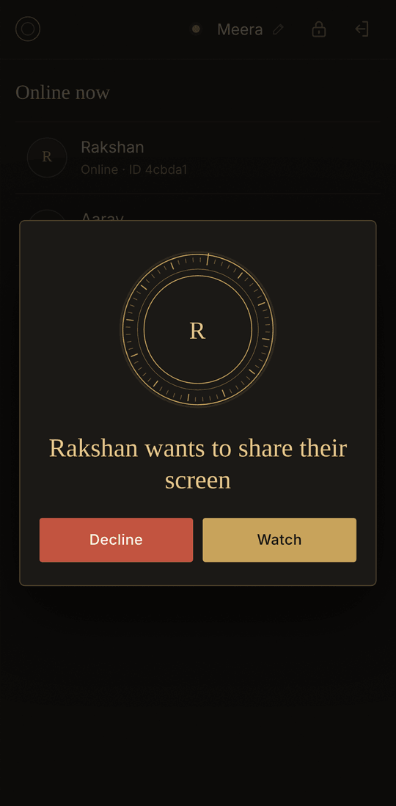 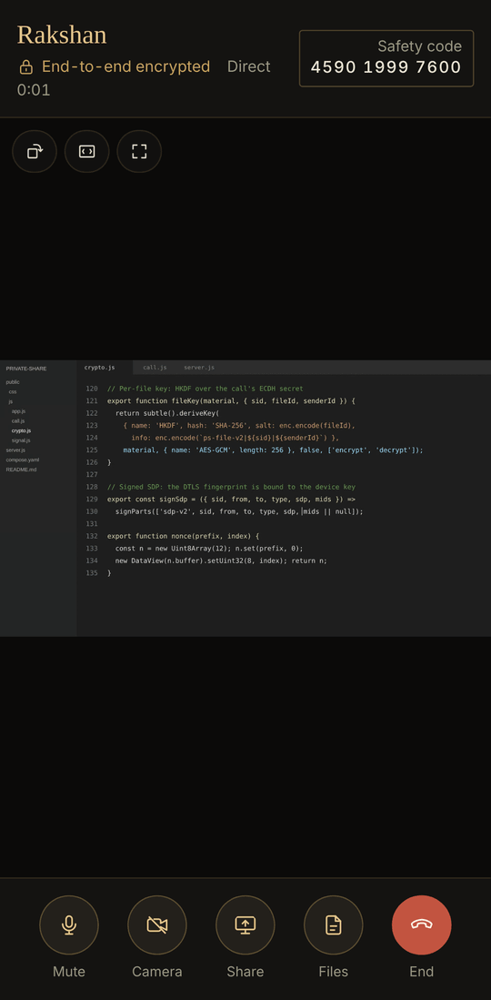 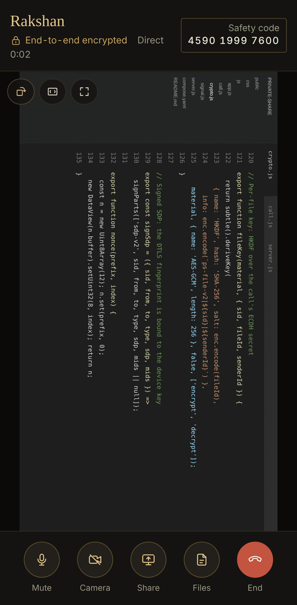

**Send files**, no call needed

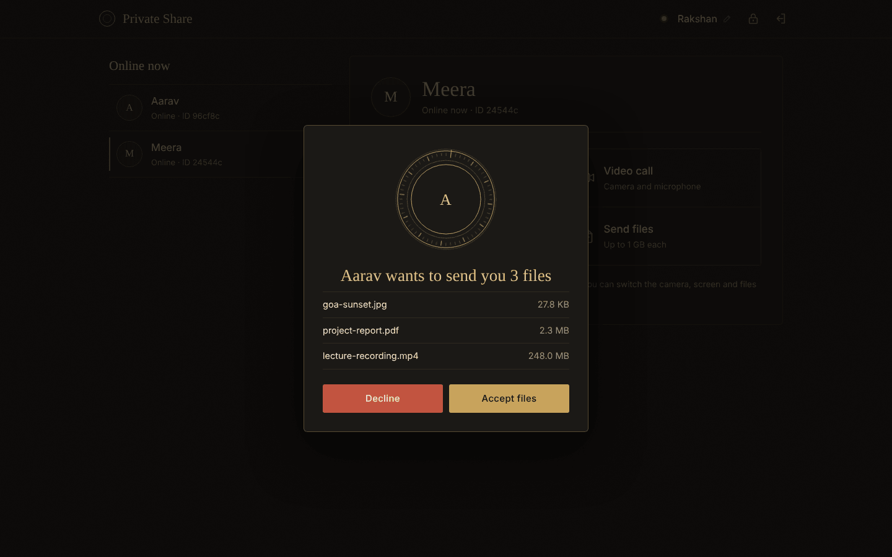 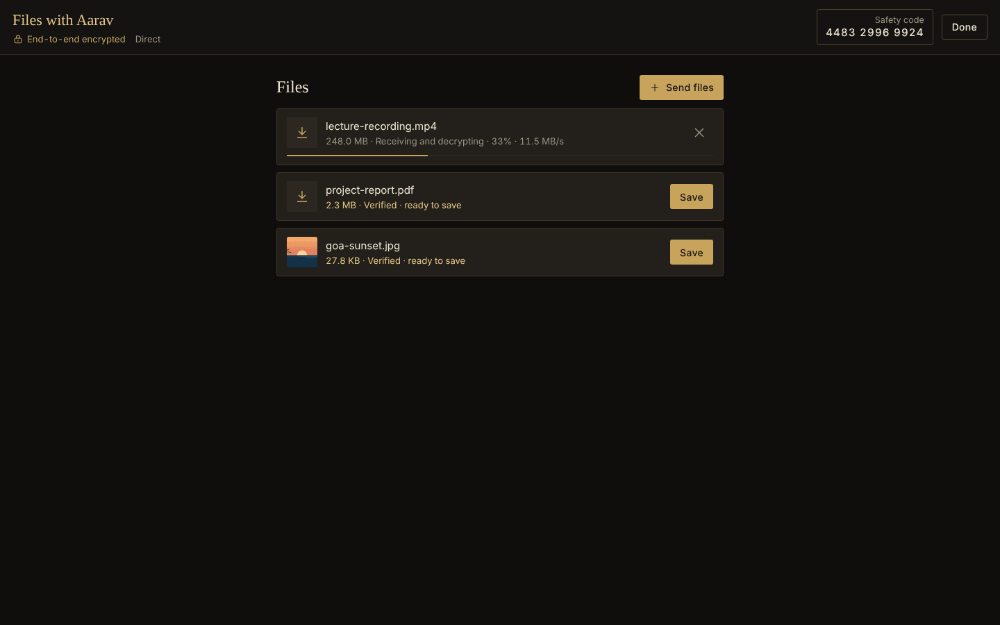
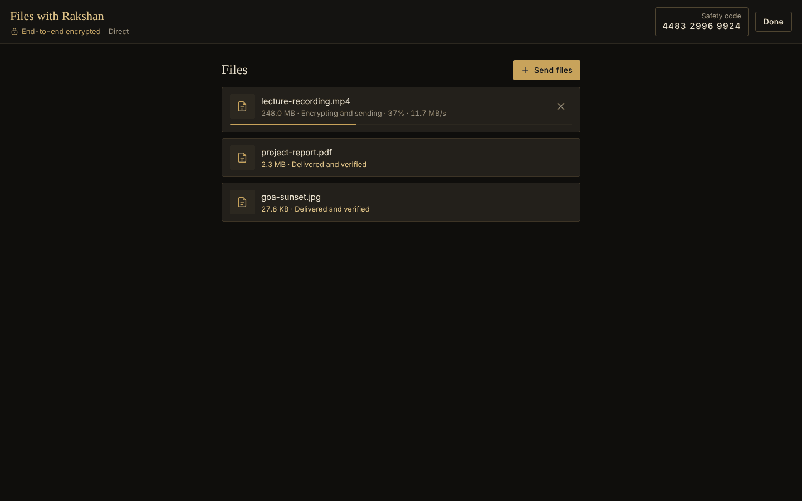 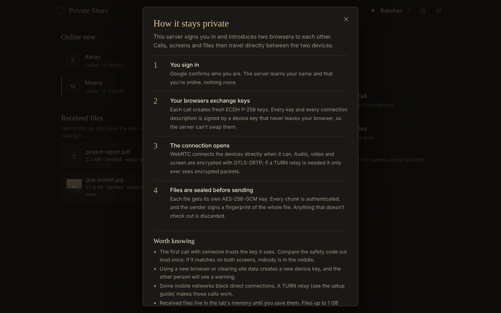

## How it works

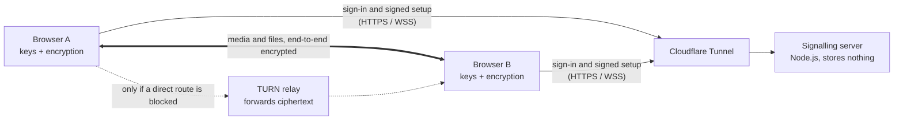

1. **Sign in.** Google confirms who you are. The server issues a short-lived session and lists who is online.
2. **Exchange keys.** Each call creates fresh ECDH P-256 keys. Every key and every connection description is signed by a device key that never leaves the browser, so the server can relay them but can't swap them.
3. **Connect.** WebRTC finds a direct route (or uses the TURN relay) and runs a DTLS handshake whose fingerprint must match the signed description.
4. **Talk, show, send.** Audio, video and screen travel over DTLS-SRTP. Files get a second layer: a per-file AES-256-GCM key, per-chunk authentication and a signed whole-file fingerprint.
5. **Hang up.** Cameras and microphones stop, the connection closes and its keys are discarded.

## Security

| Layer | Protection |
| --- | --- |
| Sign-in | Google ID token checked on the server: RS256 signature, audience, issuer, expiry and verified email. Sessions expire after 2 h idle or 24 h. |
| Device identity | ECDSA P-256 key per browser; the private key is non-extractable and stays in IndexedDB. |
| Key exchange | Fresh ECDH P-256 per call, then HKDF-SHA-256. Key bundles are signed by the device key. |
| Media | Every SDP, including its DTLS fingerprint, is signed and verified before use. Audio, video and screen use DTLS-SRTP. |
| Files | AES-256-GCM per file. Additional data binds each chunk to its call, file, index and count. A signed manifest covers a SHA-256 hash list; any failed check discards the file. |
| Trust | Keys are pinned on first contact, and a changed key raises a warning. The safety code closes the first-contact gap. |
| Server | Origin-checked WebSocket, per-call state machine, rate limits, size limits, strict CSP, read-only non-root container with all capabilities dropped. |
| Relay | Credentials derived with HMAC, expiring after 12 h. coturn is blocked from private networks and the cloud metadata address and capped at 4 Mbit/s per session. |

**Known limits.** The first call with someone trusts the key it sees until the safety code is compared. The client code comes from the same server, as in every browser-based end-to-end scheme. The server sees routing metadata (who is online, who calls whom). This project has **not** had an independent security audit. See [SECURITY.md](SECURITY.md) to report a problem.

## Quick start (local)

Needs Node.js 20 or newer. There are no packages to install.

```bash
git clone https://github.com/Rakshan-kaveri/private-share.git
cd private-share
DEV_LOGIN=true PORT=8099 node server.js
```

Open http://localhost:8099 in two windows (make the second a private window) and sign in with any name.
`DEV_LOGIN` turns on a name-only test sign-in. **Never enable it on a public server.**

## Deploy

```bash
cp .env.example .env && chmod 600 .env
nano .env                                          # GOOGLE_CLIENT_ID and APP_ORIGIN at minimum
sudo docker compose up -d --build                  # the app, on 127.0.0.1 only
sudo docker compose --profile turn up -d coturn    # optional TURN relay
```

- **HTTPS:** publish the app through Cloudflare Tunnel (or any reverse proxy that passes WebSockets). Cameras and microphones need HTTPS.
- **Google sign-in:** add your exact site origin under *Authorized JavaScript origins* for the OAuth web client.
- **TURN relay:** needed when one side is on mobile data behind carrier-grade NAT or on strict Wi-Fi. It needs a public IP and inbound UDP/TCP 3478 plus UDP 49160–49200. Cloudflare Tunnel can't carry it.
- **Google Cloud:** [`deploy/GOOGLE-CLOUD.md`](deploy/GOOGLE-CLOUD.md) and `bash deploy/gcp-setup.sh` set up the app and the relay on one VM. The script also prints the firewall commands.

In the app, the lock menu's **Check relay** button confirms the relay is reachable.

### Configuration

| Variable | Purpose | Example |
| --- | --- | --- |
| `GOOGLE_CLIENT_ID` | Google OAuth web client ID (public) | `1234-abc.apps.googleusercontent.com` |
| `APP_ORIGIN` | Exact public origin; WebSocket connections must come from it | `https://share.example.com` |
| `HOST_PORT` | Loopback port the reverse proxy points at | `8188` |
| `TURN_HOST` | Relay hostname or public IP given to browsers | `turn.example.com` |
| `TURN_PUBLIC_IP` | `public/private` address pair for coturn behind 1:1 NAT | `203.0.113.5/10.0.0.2` |
| `TURN_SHARED_SECRET` | Shared by the app and coturn; generate with `openssl rand -hex 32` | — |
| `TURN_PORT`, `TURN_TLS_PORT` | Relay ports (`TURN_TLS_PORT=0` turns TLS off) | `3478`, `0` |
| `ICE_SERVERS_JSON` | Extra STUN/TURN servers | `[]` |
| `DEV_LOGIN` | Name-only test sign-in; keep `false` in production | `false` |

## Tests

[`tests/e2e.mjs`](tests/e2e.mjs) runs two real Chromium browsers (plus a phone-sized one) against the server and checks 27 things. They include: video and audio both ways, matching safety codes, camera toggling, screen sharing with sound, rotate and fill for viewers, a 24 MB file with an identical SHA-256 in both directions, declines, voice-to-video upgrade, file-only sessions with no audio, HTML in display names rendered as text, and the key-change warning.

```bash
npm install && npx playwright install chromium     # test tools only
DEV_LOGIN=true PORT=8099 node server.js &
npm test
```

## Project layout

```
server.js               HTTP, Google sign-in check, TURN credentials, WebSocket signalling (no dependencies)
public/index.html       page shell and icons
public/css/app.css      matte black and gold theme, phone layout
public/js/crypto.js     identity keys, signatures, ECDH/HKDF, AES-GCM, key pinning, safety code
public/js/call.js       session engine: media, negotiation, diagnosis, encrypted file transfer
public/js/signal.js     WebSocket client with reconnect and keep-alive
public/js/app.js        interface and viewer tools
tests/e2e.mjs           end-to-end browser tests
compose.yaml            hardened app container + optional coturn relay
deploy/                 Google Cloud guide and setup script
docs/screenshots/       images used in this README
legacy/v5/              the previous Spring Boot + React version, kept for reference
```

See [CHANGELOG.md](CHANGELOG.md) for what changed between versions.
